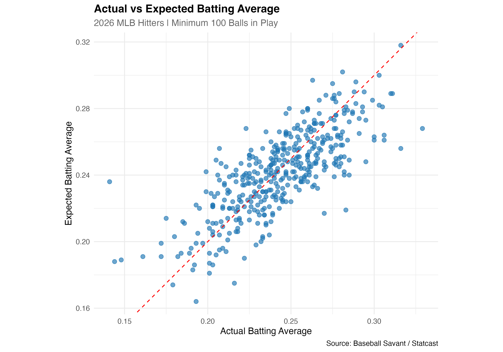
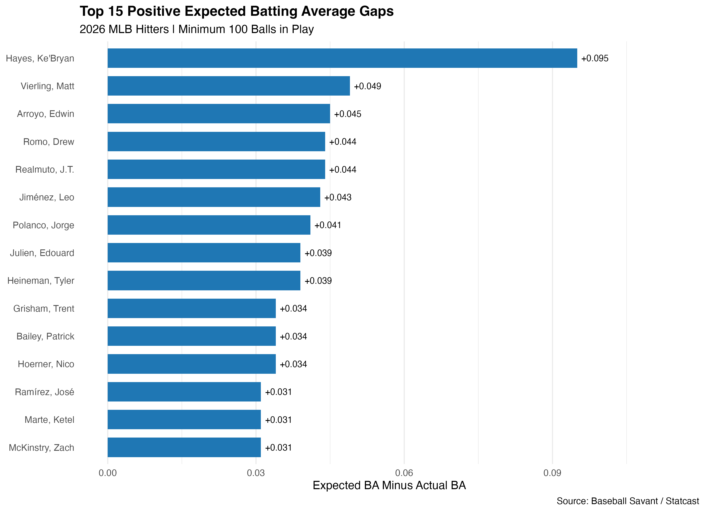
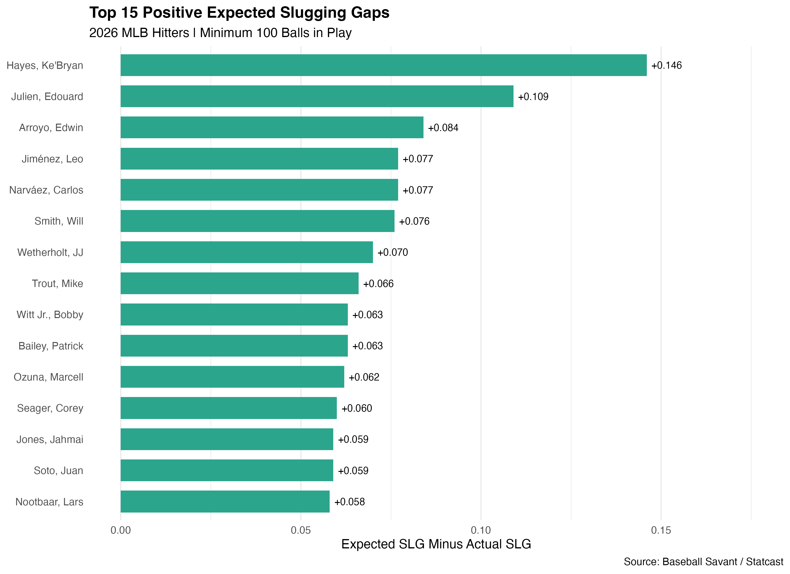
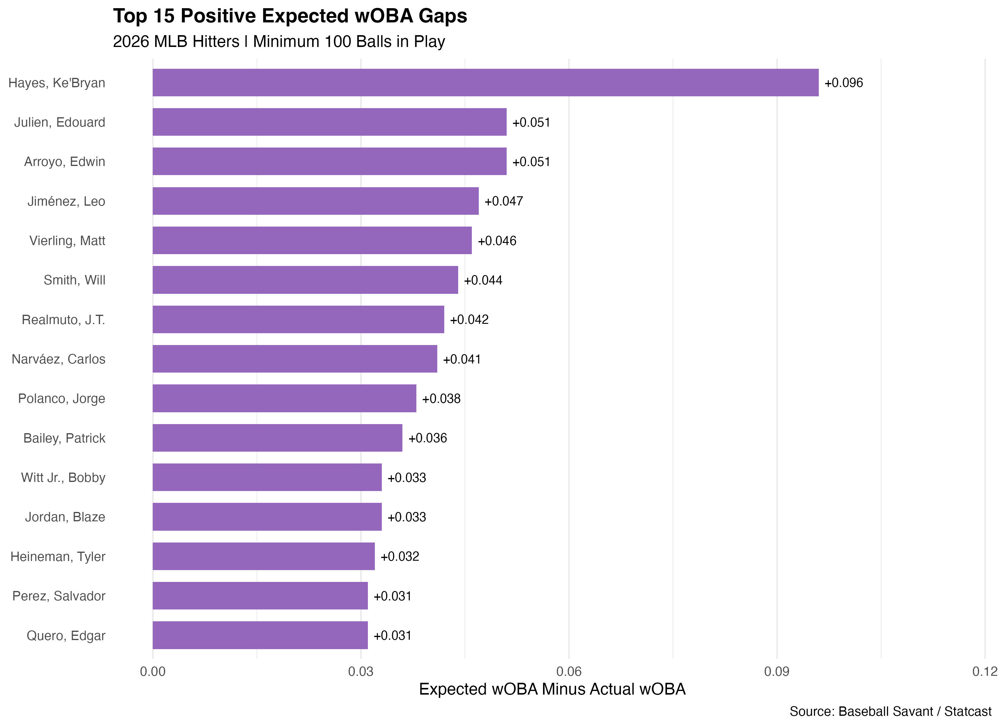
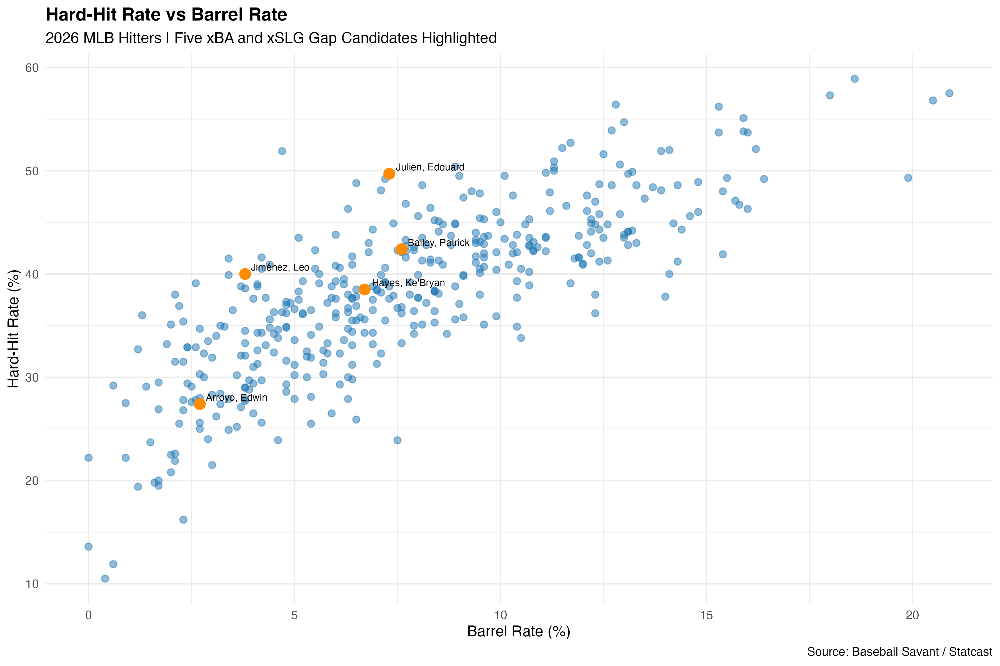
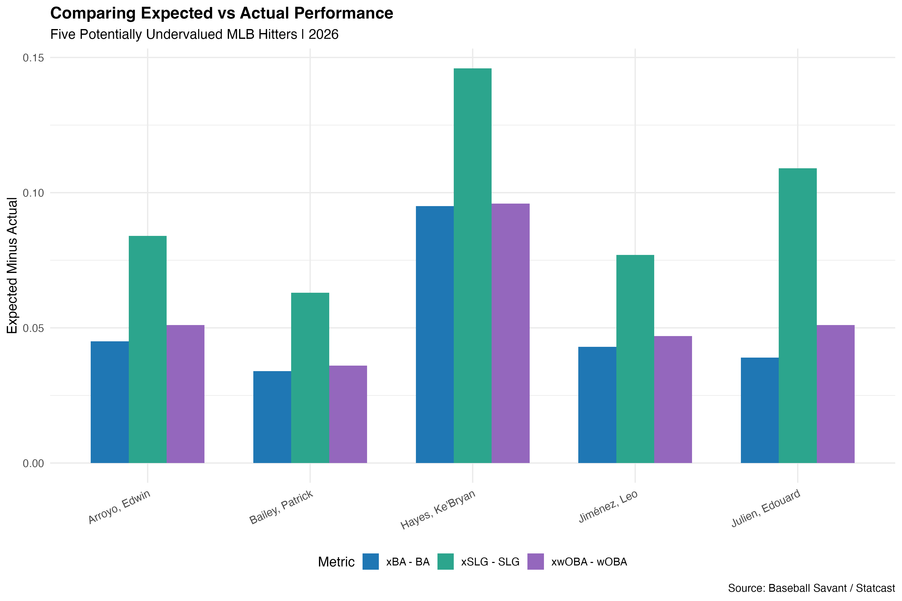
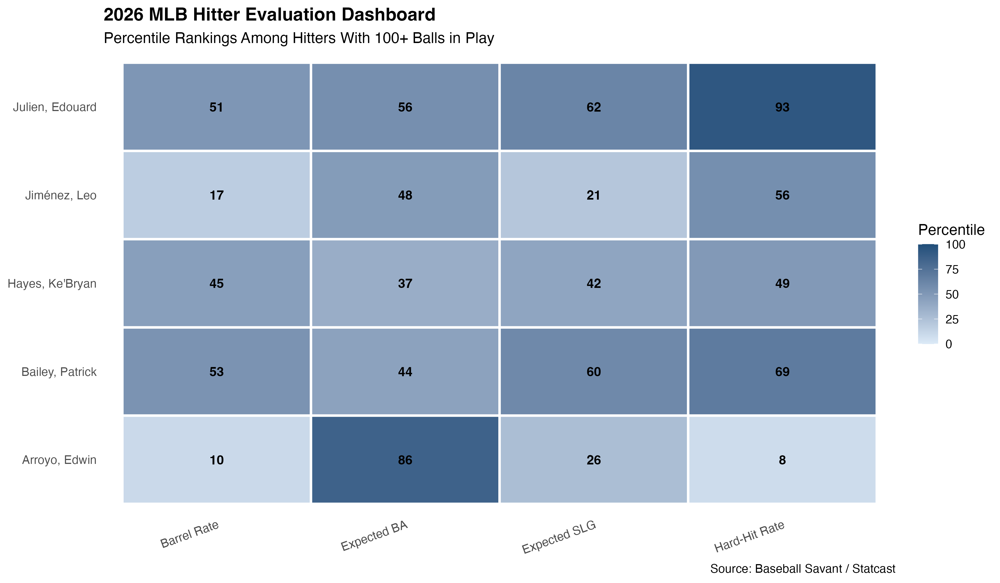
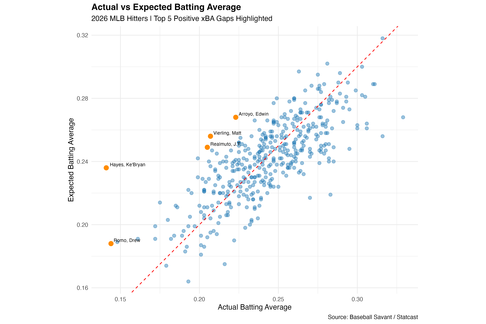

# Identifying Undervalued MLB Hitters | 2026 Statcast Analysis

## Project Overview
This project uses 2026 MLB Statcast data to identify hitters whose actual offensive production fell below their expected statistics. The goal is to find players who may deserve further scouting or analysis based on underlying contact quality and expected performance.

The analysis compares 406 hitters with at least 100 balls in play using expected batting average (xBA), expected slugging (xSLG), expected weighted on-base average (xwOBA), barrel rate, and hard-hit rate.

## Research Question
Which MLB hitters have the largest positive gaps between expected and actual offensive production, and which have underlying contact-quality indicators that support further investigation?

## Tools and Data
- R and RStudio
- tidyverse, dplyr, tidyr, ggplot2
- Baseball Savant / Statcast
- 2026 MLB hitter leaderboards

## Methodology
1. Downloaded expected-statistics and exit-velocity/barrel leaderboards from Baseball Savant.
2. Joined the datasets using MLB player IDs.
3. Evaluated 406 hitters with at least 100 balls in play in the merged sample.
4. Calculated expected-minus-actual gaps for BA, SLG, and wOBA.
5. Compared barrel rates, hard-hit rates, and percentile rankings.
6. Selected five players for further evaluation and created seven visualizations.

The expected-statistics export used a minimum of 100 BIP; the contact-quality export used a minimum of 100 BBE. The season-type scope was not independently confirmed from the displayed leaderboard filters.

## Five Hitters Evaluated

| Player | xBA - BA | xSLG - SLG | xwOBA - wOBA | Hard-Hit Rate |
|---|---:|---:|---:|---:|
| Ke'Bryan Hayes | +.095 | +.146 | +.096 | 38.5% |
| Edouard Julien | +.039 | +.109 | +.051 | 49.7% |
| Edwin Arroyo | +.045 | +.084 | +.051 | 27.4% |
| Leo Jiménez | +.043 | +.077 | +.047 | 40.0% |
| Patrick Bailey | +.034 | +.063 | +.036 | 42.4% |

## Key Findings
- **Ke'Bryan Hayes:** Largest expected-versus-actual gaps among the five candidates, but contact-quality percentiles are closer to average.
- **Edouard Julien:** Strongest hard-hit profile of the group, with a 49.7% hard-hit rate (93rd percentile of the dataset).
- **Edwin Arroyo:** Positive expected-stat gaps, but a low hard-hit rate suggests caution.
- **Patrick Bailey:** More balanced contact-quality indicators and a larger sample than several other candidates.
- **Leo Jiménez:** Positive gaps warrant further investigation, although his barrel-rate percentile is relatively low.

These findings identify potential underperformance relative to expected statistics, not confirmed financial undervaluation or guaranteed future improvement.

## Visualizations

### Actual vs Expected Batting Average

### Top 15 xBA Gaps

### Top 15 xSLG Gaps

### Top 15 xwOBA Gaps

### Hard-Hit Rate vs Barrel Rate

### Five-Player Comparison

### Hitter Evaluation Dashboard

### Additional Highlighted Chart

## Full Scouting Report
[Read the scouting and analytics report (PDF)](MLB_2026_Undervalued_Hitters_Scouting_Report.pdf)

## Limitations
- Expected statistics describe quality of contact and expected outcomes; they do not guarantee future performance.
- Smaller samples can create larger gaps and less stable rankings.
- Ballpark, defense, opponent quality, and player development context require additional investigation.
- This project does not include contracts, salaries, or acquisition costs.

## Author
Corey Bannerman  
Aspiring Baseball Analyst | Sport Management | R & Tableau  
[GitHub Profile](https://github.com/coreybann)
